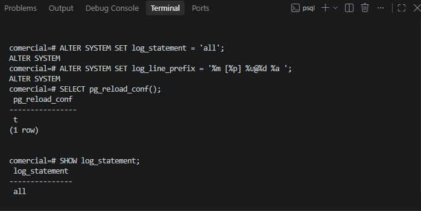

# Evidencia 04: Configuración de Bitácora y Prefijos de Línea

**Estudiante:** Jesús Sauceda  
**Servidor:** PostgreSQL 18.6 (Local)  
**Base de datos:** comercial  



## 1. Comandos Ejecutados
```sql
ALTER SYSTEM SET log_statement = 'all';
ALTER SYSTEM SET log_line_prefix = '%m [%p] %u@%d %a ';
SELECT pg_reload_conf();
```

## 2. Explicación de Prefijos
* `%m`: Timestamp (fecha y hora).
* `%p`: PID del proceso.
* `%u@%d`: Usuario y Base de Datos (`postgres@comercial`).
* `%a`: Aplicación cliente (`psql`).